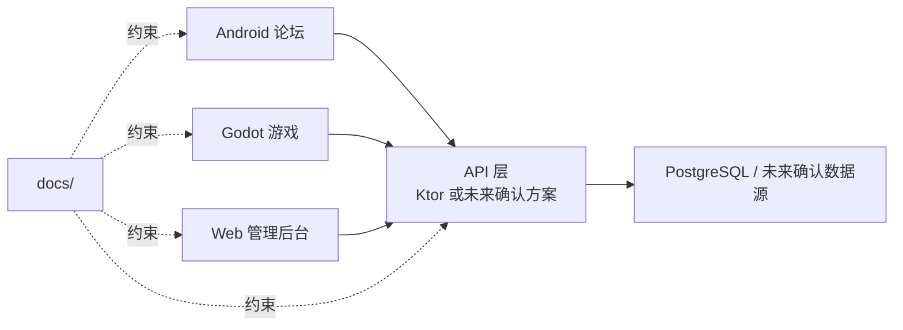

# 架构基线

本文档只写当前基线。历史文档若冲突，以 `PROJECT_CENTER.md` 和用户最新指令为准。

## 1. 当前结论

- Godot 游戏端、Android 论坛端优先独立仓库。
- 根目录 `D:\Cards-All` 是总工作区和文档中枢。
- 后端当前是 Ktor 学习支线，不急着承担项目主线。
- Android / Godot 可以先用 mock、临时 API 或已确认的数据源。
- 客户端不能直接连接数据库。
- 每个成员必须在自己的分支工作，确认后再提交/合并。

## 2. 目标结构



## 3. 依赖方向

通用方向：

```text
UI -> 状态/ViewModel/Controller -> Repository/Service -> API/数据源
```

禁止：

- UI 直接散落数据库或后端细节。
- 多端各自猜字段。
- 客户端直连 PostgreSQL。
- 为了快把业务规则复制到多个端。

## 4. Ktor 学习支线

当前目标：

- `/ping`
- JSON 请求/响应。
- PostgreSQL 本地连接。
- 最小 CRUD。
- route / service / repository / dto 分层。
- 局域网访问。

暂不负责：

- 完整项目后端。
- 线上部署。
- 复杂权限。
- 联机游戏结算。

## 5. Git 架构规则

- `master` / `main` 只放用户确认后的稳定结果。
- 成员只在自己的任务分支工作。
- 分支名用短横线，例如 `ktor-learning-ping`。
- 未经用户确认，不 commit / merge / push。
- 合并前必须有交接和验证结果。

## 6. 需要 ADR 的情况

以下情况必须写 ADR 或更新中心文档：

- 后端从学习支线变成项目主线。
- 选择 Supabase、Ktor 或混合架构。
- 引入新框架、数据库、部署方式。
- 改变仓库拆分方式。
- 改变账号、权限、支付、审核等关键规则。

## 7. 当前风险

- 旧 README、旧 handoff、旧 Supabase 文档可能过期。
- Android 现有代码可能已有 Supabase 依赖，改动前要先查代码。
- 根目录已有 `.idea/` 未跟踪，不要误提交。
- 文档要继续保持短小，避免消耗成员上下文。
