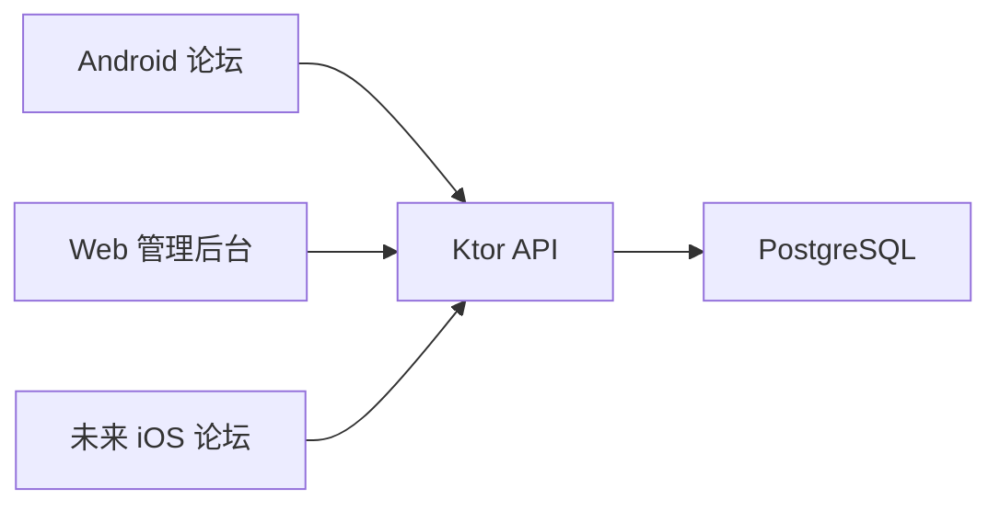

# 架构基线

## 1. 当前结构

- `community`：Android 论坛客户端，独立生成 APK。
- `server`：Ktor JVM 服务，独立运行。
- Supabase 仅保留为备用资料，当前后端主线是 Ktor。
- 客户端不能直接连接数据库。
- 每个成员在自己的分支工作，用户确认后才能提交、合并或推送。

## 2. 数据流



客户端通用依赖方向：

```text
UI -> 状态/ViewModel -> Repository -> API
```

后端通用依赖方向：

```text
Route -> Service -> Repository -> PostgreSQL
```

## 3. 当前后端学习目标

- HTTP 与 JSON 请求/响应。
- 帖子最小 CRUD。
- PostgreSQL 本地连接。
- route / service / repository / dto 分层。
- 统一错误处理、鉴权、日志、配置和测试。
- 局域网访问与后续部署基础。

## 4. 禁止事项

- UI 直接包含数据库或后端细节。
- 客户端直连 PostgreSQL。
- 多端各自猜测接口字段。
- 密钥、密码和服务器地址硬编码后提交。
- 为了省事绕开权限、错误处理和验证。

## 5. 需要 ADR 的变化

- 更换主后端、数据库或部署方式。
- 引入新的核心框架。
- 改变仓库拆分方式。
- 改变账号、权限、审核等关键规则。
