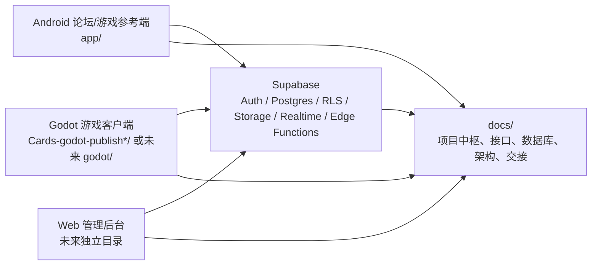

# Cards-All 架构文档

本文档由架构成员维护，用于沉淀 Cards-All 的模块边界、依赖方向、数据流、接口契约原则和关键架构风险。若本文档与 `docs/PROJECT_CENTER.md` 冲突，以 `docs/PROJECT_CENTER.md` 为准；若需要改变最高层方向，应先更新项目中枢或补充 ADR。

## 1. 架构成员职责

架构成员当前负责：

- 先确认项目事实，再设计模块边界，不凭记忆改代码。
- 统一 Android、Godot、Web 管理后台、Supabase 之间的概念命名。
- 决定业务逻辑、状态同步、权限校验分别放在哪一层。
- 输出数据流、模块图、接口契约和关键取舍。
- 发现重大路线冲突时，记录为架构风险，并交给团队大脑或用户拍板。

架构成员不直接替代各端成员长期维护具体 UI、具体页面或具体 SQL；但可以为这些成员提供边界、契约和审查意见。

## 2. 当前事实来源

已确认的高优先级文档：

- `docs/PROJECT_CENTER.md`：项目最高层事实来源。
- `docs/TEAM_RULES.md`：所有成员工作流程和职责规则。
- `docs/SUPABASE_LEARNING.md`：Supabase 后端学习和任务输出方式。
- `docs/handoff/2026-06-02-godot-ui-computer-use.md`：最近 Godot UI 方向交接。

已确认的当前代码事实：

- 根目录 `D:\Cards-All` 目前不是 Git 仓库，只是本地总工作区和文档中枢。
- Android 端在 `app/`，使用 Kotlin 和 Supabase 客户端。
- `server/` 存在 Ktor 骨架，目前只有 `/ping`，不是当前主线后端。
- `godot/` 目录当前为空。
- Godot 可运行代码当前在 `Cards-godot-publish/` 和 `Cards-godot-publish-20260521220255/` 发布目录中。
- Supabase schema 当前记录在 `docs/supabase_schema.sql`。

需要注意的历史冲突：

- 根 `README.md` 出现编码乱码，并且内容保留了 Ktor 自建后端路线。
- `Cards-godot-publish*/PORTING_NOTES.md` 末尾仍提到后续可用 Ktor 替换 Supabase。
- `docs/PROJECT_CENTER.md` 和 `docs/TEAM_RULES.md` 已明确：当前暑假和学期主线只使用 Supabase，不安排自建独立后端。

因此，当前架构基线以 Supabase 主线为准；Ktor 只视为历史骨架或学习实验，不能继续扩大为主线，除非写入 ADR 并由团队大脑或用户确认。

## 3. 总体架构



当前产品不是单一小游戏，而是围绕原创卡牌/策略游戏展开的多端社区产品。推荐的长期模块边界如下：

- Godot 游戏客户端：负责游戏表现、场景交互、战斗 UI、玩家输入和可玩体验。
- Android 论坛端：负责论坛主流程、用户资料、帖子、评论和移动端展示。
- Supabase：负责账号、数据库、权限、文件、实时通知和必要服务端逻辑。
- Web 管理后台：负责内容审核、用户管理、公告、配置和数据查看。
- 文档中枢：负责跨端契约、路线图、交接、ADR 和毕设材料。

## 4. 依赖方向

必须保持的依赖方向：

```text
UI 页面
-> 页面状态 / ViewModel / Screen Script
-> Repository / Service / Data Client
-> Supabase API / Postgres / Storage / Realtime
```

禁止的依赖方向：

```text
Supabase schema 依赖某个客户端页面实现
Godot 直接复制 Android UI 业务细节而不沉淀契约
Android UI 直接散落 Supabase 查询和权限假设
Web 管理后台绕开权限直接改普通用户数据
多个客户端维护不一致的同一套业务模型
```

架构原则：

- 客户端可以做交互校验，但不能作为最终权限来源。
- 数据正确性优先由 PostgreSQL 约束、索引、RLS 和必要的 Edge Function 保证。
- 角色、卡牌、房间、帖子、评论等跨端概念必须有统一命名。
- Godot 和 Android 可以各自有 UI 模型，但同步到 Supabase 的字段必须对齐。

## 5. 当前核心数据

`docs/supabase_schema.sql` 当前包含：

```text
player_account
player_profile
player_characters
game_room_state
game_result
```

当前状态说明：

- `player_account` 使用自定义账号表和密码 hash，不是 Supabase Auth。
- `game_room_state.state_json` 用 JSONB 保存房间或战斗状态快照。
- `player_profile` 保存头像、金币点数和当前选中角色。
- `player_characters` 保存玩家拥有角色。
- `game_result` 预留对战结果统计。
- RLS 当前未开启，schema 注释写明“当前仍使用 anon key 直连，先不开启”。

这适合早期跑通玩法，但不适合作为长期求职版和毕设版的最终后端安全方案。后续应优先补齐：

- 使用 Supabase Auth 或明确记录继续自定义账号的 ADR。
- 为公开数据、个人资料、角色拥有关系、房间状态分别设计 RLS。
- 把头像 base64 逐步迁移到 Storage。
- 为帖子、评论、点赞、收藏、审核状态补充论坛数据模型。

## 6. 关键数据流

### 登录与资料

```text
客户端输入账号密码
-> AuthRepository / AuthService
-> Supabase player_account 查询或插入
-> player_profile 初始化或读取
-> 客户端保存本地会话
```

目标演进：

```text
客户端使用 Supabase Auth
-> Auth user id 作为用户身份来源
-> profiles 表保存业务资料
-> RLS 使用 auth.uid() 控制读取和修改
```

### 角色与抽取

```text
客户端触发抽取或兑换
-> 本地规则计算候选结果
-> player_characters upsert
-> player_profile 更新 lottery_points / selected_character
```

长期建议：

- 抽取概率、消耗、奖励规则写入配置表或 Edge Function，避免多个客户端分叉。
- 客户端只展示结果和提交意图，不应各自维护不一致的经济规则。

### 房间与对战

```text
创建/加入房间
-> game_room_state 写入 waiting 状态
-> 双方进入战斗
-> 客户端提交行动
-> 计算新 GameRoomState
-> upsert game_room_state
-> 另一端轮询或订阅刷新
-> 结束后写入 game_result
```

当前可以先用 HTTP 轮询跑通。后续如果进入更完整联机体验，再评估 Realtime 或 Edge Function 承担更强的一致性校验。

### 论坛与后台

论坛和后台当前是暑假 MVP 的高优先级，但文档和 schema 还未完整落地。建议最小契约：

```text
profiles
posts
comments
post_likes
post_favorites
announcements
moderation_actions
```

后台不应成为“静态页面”。最小后台必须至少能对真实数据执行一到两个运营操作，例如帖子审核、用户查看、公告发布。

## 7. 模块边界建议

### Android 端

建议维持：

- Activity / Fragment 负责页面展示和导航。
- ViewModel 负责页面状态和用户动作编排。
- Repository 负责 Supabase 数据访问。
- GameEngine 和 GameModels 负责纯规则逻辑，避免依赖 Android UI。

需要避免：

- Activity 直接拼接 Supabase 查询。
- 多个页面复制同一套房间、角色、账号逻辑。
- 把密码、权限、审核状态等长期规则只放在前端判断。

### Godot 端

建议维持：

- `scenes/` 只作为页面入口。
- `scripts/screens/` 负责具体页面交互。
- `scripts/core/` 负责全局状态和路由。
- `scripts/data/` 负责 Supabase 通信。
- `scripts/domain/` 负责角色、卡牌和战斗规则。
- `scripts/ui/` 负责统一视觉 token 和组件工具。

需要优先澄清：

- 未来正式 Godot 仓库到底使用 `godot/`，还是继续使用 `Cards-godot-publish/`。
- 最近交接文档提到的 `godot/PAPER_STYLE_GUIDE.md` 与当前空 `godot/` 目录不一致，需要团队大脑确认并同步。

### Supabase

建议按能力拆文档：

- `docs/DATABASE.md`：表结构、索引、约束、RLS。
- `docs/API.md`：PostgREST/RPC/Edge Function 调用契约。
- `docs/SUPABASE_LEARNING.md`：教学路线和概念解释。

需要避免：

- 长期关闭 RLS。
- 用 anon key 写入所有敏感表。
- 自定义密码表长期替代 Supabase Auth 但没有 ADR。

### Web 管理后台

尚未启动时，先沉淀契约：

- 管理员如何识别。
- 哪些表允许管理员审核和修改。
- 普通用户和管理员的数据权限如何区分。
- 审核动作是否需要记录操作人、时间、原因。

## 8. 架构风险

当前最高风险：

1. 后端路线冲突：旧 README / Ktor 骨架与项目中枢 Supabase 主线冲突。
2. Godot 目录冲突：计划中的 `godot/` 当前为空，真实代码在发布目录。
3. 安全模型不足：当前 schema 关闭 RLS，且自定义账号密码表暴露在客户端直连流程中。
4. 跨端模型分叉：Android 和 Godot 都有战斗/房间逻辑，后续可能出现规则不一致。
5. 文档缺口：`DATABASE.md`、`API.md`、`PRODUCT.md`、`ROADMAP.md`、ADR 目录尚未建立。

处理顺序建议：

1. 由团队大脑确认 Godot 正式工作目录，并同步项目中枢。
2. 新建或补齐 `docs/DATABASE.md`，把当前 schema 和 RLS 演进计划写清楚。
3. 新建 `docs/API.md`，记录 Android/Godot 共同使用的 Supabase 表和字段契约。
4. 对“是否废弃 Ktor server/”写 ADR 或在项目中枢明确标记为历史实验。
5. 在进入论坛 MVP 前，先固定 `profiles/posts/comments` 的最小数据模型。

## 9. 架构决策记录规则

以下变化必须写入 `docs/adr/`：

- 从 Supabase 改回自建后端，或启动 Ktor/Nest/Spring 等独立服务。
- 从自定义账号迁移到 Supabase Auth，或决定继续自定义账号。
- 游戏战斗状态由客户端计算改为 Edge Function 或服务端计算。
- Godot 正式仓库目录从发布目录迁移到 `godot/`。
- 管理后台权限模型发生变化。

ADR 最小模板：

```text
# ADR-编号：标题

日期：
状态：提议 / 已接受 / 已废弃

背景：
决策：
影响：
替代方案：
后续动作：
```

## 10. 架构成员交接

本次角色：
架构成员。

本次目标：
阅读项目 Markdown 文档，确认架构职责，并创建架构成员负责维护的文档。

已完成：
- 阅读 `docs/PROJECT_CENTER.md`、`docs/TEAM_RULES.md`、`docs/SUPABASE_LEARNING.md`。
- 阅读 Godot 最近交接与发布目录说明。
- 确认 Android、Godot、Supabase、Ktor 骨架和文档之间的当前状态。
- 创建 `docs/ARCHITECTURE.md`。

重要决策：
- 当前架构文档以 Supabase 主线为准。
- Ktor `server/` 暂不视为当前主线后端。
- Godot 正式目录未确认前，文档同时记录空 `godot/` 和发布目录现状。

未完成/遗留问题：
- 尚未补齐 `docs/DATABASE.md`、`docs/API.md`、`docs/PRODUCT.md`、`docs/ROADMAP.md`。
- 尚未写 ADR 标记 Ktor 骨架的最终处理方式。
- 尚未修复根 `README.md` 的编码和路线冲突。

下一步建议：
- 先让团队大脑确认 Godot 正式工作目录。
- 再由 Supabase 成员补 `docs/DATABASE.md` 和 RLS 演进计划。
- 架构成员随后补第一批 ADR，尤其是 Supabase 主线与 Ktor 历史骨架的取舍。
